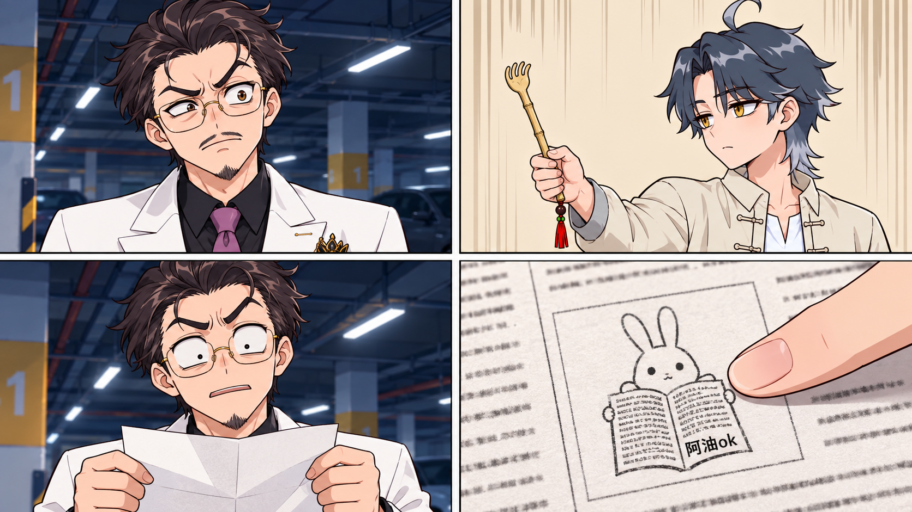
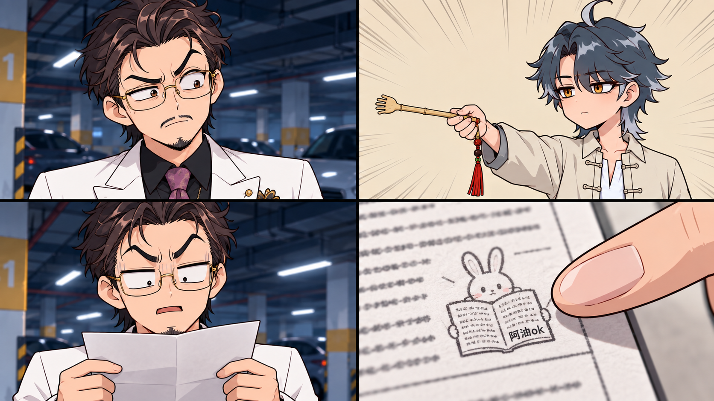

# 第三章·停车场解围：三个单元交付

已按单元顺序完成文字与预览，每单元三次独立生成四宫格。最新站位图与竹制痒痒挠参考已采用。

## 单元1：带走与反击

[分镜脚本](第三章_停车场解围_单元01.md)

### 预览1

### 预览2

### 预览3

## 单元2：违约条款

[分镜脚本](第三章_停车场解围_单元02.md)

### 预览1

### 预览2

### 预览3

## 单元3：跟我玩阴的

[分镜脚本](第三章_停车场解围_单元03.md)

### 预览1

### 预览2

### 预览3

预览选择建议：单元1、2优先参考第3版。单元3第3版可参考表情和动作构图，但末格持挠手错误，生成视频时按文字锁定右手；不要将该末格直接作为连续性定稿。
